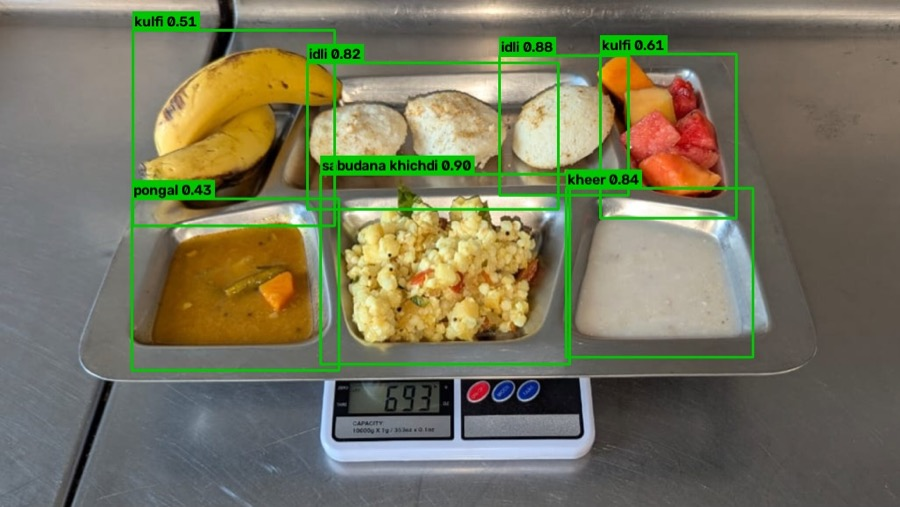

# Khana Thali Vision

Recognise the dishes on an Indian thali from a photo, in three stages:

1. **Classify** a single dish into one of 80 classes. ConvNeXt-Small fine-tuned on the
   [Khana dataset](https://arxiv.org/abs/2509.06006) (131K images): **95.78% top-1** on the test set.
2. **Detect** each compartment of a top-down thali with YOLOv8n, then label every crop with the Task 1 classifier.
3. **Correct the viewing angle**: find the tray in an angled photo, warp it to a top-down view with a
   homography, then run Task 2 on the result.



## Run it

Requires [uv](https://docs.astral.sh/uv/). On first run the script downloads the two model files
(793 MB classifier, 6 MB detector) from this repo's [v1.0 release](https://github.com/kartikeyaagr/Khana-Thali-Vision/releases/tag/v1.0).

```bash
./run_all.sh
```

That runs all three tasks on the 15 sample thalis in `data/images/` and writes:

| Path | Contents |
|---|---|
| `outputs/task2/` | Annotated thalis + `predictions.json` (label, confidence, bbox per compartment) |
| `outputs/task3/bev/` | Top-down warps |
| `outputs/task3/detected/` | Top-down warps annotated with dish labels, + `predictions.json` |

Task 3 reads `data/angled/` and falls back to `data/images/` when that folder is empty. Drop angled
photos into `data/angled/` to see the perspective correction do real work.

If the Khana dataset is unpacked at `khana/` (one folder per class), the script also evaluates the
classifier on the held-out test split. `./run_all.sh --train` retrains both models first: the classifier
needs `khana/` and a CUDA GPU; the detector trains on CUDA, Apple Silicon or CPU.

Runs on macOS (MPS), Linux/Windows (CUDA 12.8) or CPU.

## Task 1: dish classification

Two-phase fine-tune of `convnext_small.fb_in22k_ft_in1k`, tracking an EMA of the weights throughout:

1. **Phase 1:** 224px, MixUp/CutMix, stem frozen for the first 5 epochs.
2. **Phase 2:** progressive resolution (320px, then 384px) on hard labels, layer-decay AdamW, batch size scaled by image area.

Split 80/10/10 with a fixed seed: 105,455 train / 13,182 val images.

| Stage | Resolution | Epochs | EMA top-1 | EMA top-5 |
|---|---|---|---|---|
| Phase 1 | 224px | 50 | 95.60% | 99.28% |
| Phase 2 | 320px | 8 | 95.84% | 99.20% |
| Phase 2 | 384px | 8 | 95.70% | 99.10% |
| **Test set** | **384px** | | **95.78%** | **98.93%** |
| Test set + 5-crop TTA | 384px | | 95.77% | 98.98% |

Rows 1–3 are validation accuracy. The test figures come from the 384px checkpoint
(`classification/results/384/results_test.json`). The released weights are the **320px** checkpoint,
which Tasks 2 and 3 were built on; it scored 95.84% on validation.

Hardest classes on the test set: amritsari kulcha (48.1%), phirni (74.3%), chicken pizza (82.7%),
aloo methi (83.3%), pepperoni pizza (84.4%). Full per-class results, the confusion matrix and the
training curves are in `classification/results/`.

| Choice | Why |
|---|---|
| ConvNeXt-Small (50M params) | Strong ImageNet-22K pretraining; outperforms ResNet-50 at similar FLOPs |
| EMA, decay 0.9998 | +0.3–0.5% over the raw weights |
| Layer decay 0.75 | Lower LR for early layers so pretrained features survive |
| Progressive resolution | Higher resolution recovers fine texture |
| Weighted sampler (power 0.5) | Soft rebalancing without fully oversampling rare classes |

Individual steps, run from the repo root:

```bash
uv run python classification/prepare_splits.py              # khana/ → splits/manifest.json
uv run --extra train python classification/pipeline.py     # phase 1 → 320px → test eval
uv run --extra train python classification/pipeline.py --finetune-sizes 320 384
uv run python classification/evaluate.py --checkpoint models/320/best_ema_hires.pt --image-size 320 --tta
uv run --extra train mlflow ui --backend-store-uri sqlite:///mlruns.db
```

`classification/diffusion_classify.py` is a zero-shot baseline that scores classes by
Stable Diffusion 2.1 reconstruction error (`uv sync --extra train` first).

## Task 2: thali compartment detection

`thali/detector.py` tries three detectors in order and stops at the first that returns boxes:

1. **YOLOv8n** fine-tuned on 19 annotated thalis (`detection/finetune_images/`, offline-augmented 10× with
   rotations, flips and colour jitter), with custom NMS and size/aspect filters.
2. **Contours:** auto-Canny, morphological close, 4–8-sided polygons with fill ratio ≥ 0.45.
3. **Colour:** k-means (k=10) in LAB space, connected components per cluster.

Each box is padded, cropped and labelled by the Task 1 classifier.

```bash
uv run python -m detection.run --images data/images --output outputs/task2
uv run python -m detection.debug_detect            # YOLO boxes only, to tune thresholds
uv run python -m detection.evaluate --predictions outputs/task2/predictions.json --ground-truth gt.json
uv run --extra train python -m detection.finetune  # retrain → models/thali_detector.pt
```

`detection.evaluate` scores label precision/recall per image (boxes are ignored). Ground truth is
`{"image.jpg": ["rice", "dal"]}` or `{"image.jpg": [{"label": "rice"}]}`.

## Task 3: top-down view correction

1. Find the tray's four corners: Otsu threshold, then GrabCut, then Canny edges. A quad that spans
   the whole image is rejected and the next method is tried.
2. Warp with `cv2.getPerspectiveTransform`, sizing the output from the corner geometry so the tray keeps its aspect ratio.
3. Run the Task 2 detector and classifier on the warped image.

```bash
uv run python -m bev.bev_pipeline --images data/angled --debug   # --debug saves the detected corners
uv run python -m bev.annotate                                    # click corners by hand if detection fails
```

The script prints a foreshortening ratio (top edge / bottom edge) per image: 1.0 is already top-down.
Below 0.3 the far edge has too few pixels to recover and the warp is visibly stretched; reshooting
at 45° or steeper fixes that. A tray the same colour as the surface under it can defeat all three corner detectors.

## Layout

```
run_all.sh          one command for everything
classification/     Task 1: training, evaluation, results
detection/          Task 2: inference, detector fine-tuning, evaluation
bev/                Task 3: perspective correction, manual corner tool
thali/              shared detector + classifier + visualisation used by Tasks 2 and 3
data/               80 class names, sample thalis, data/angled/ for Task 3 inputs
```

## Credits

The Khana dataset is by Omkar Prabhu ([arXiv:2509.06006](https://arxiv.org/abs/2509.06006)).
This repo trains on it; the paper is theirs.

This project was originally three repos, one per task; they're merged here with their code unchanged except for paths and bug fixes.
